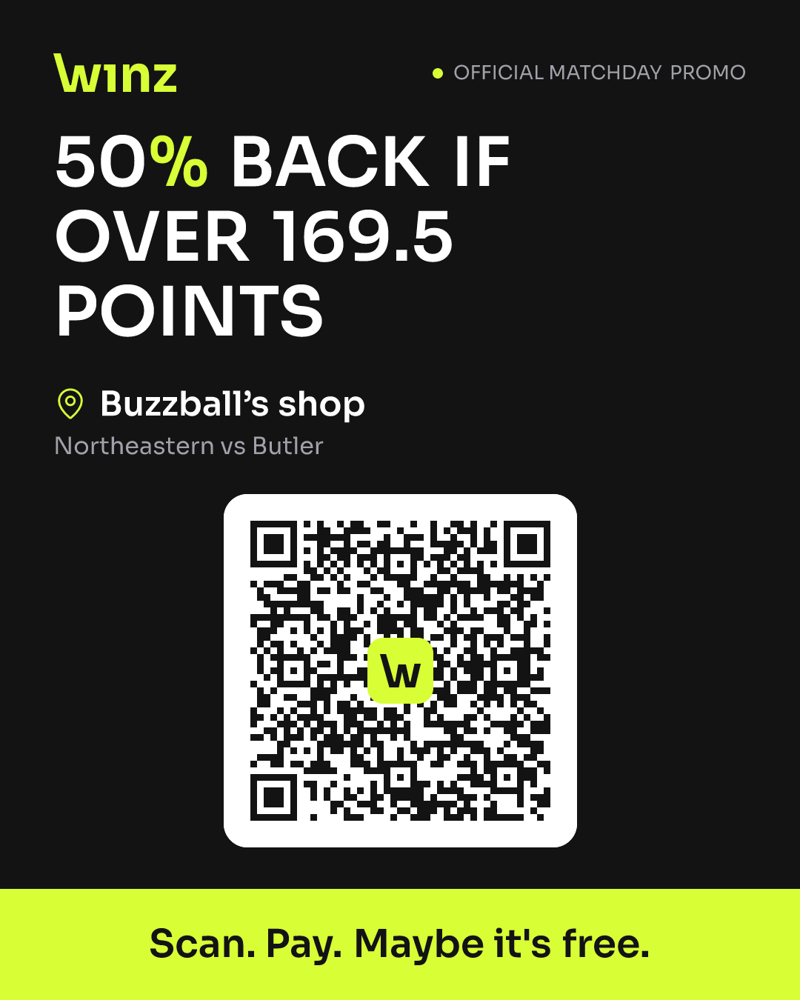
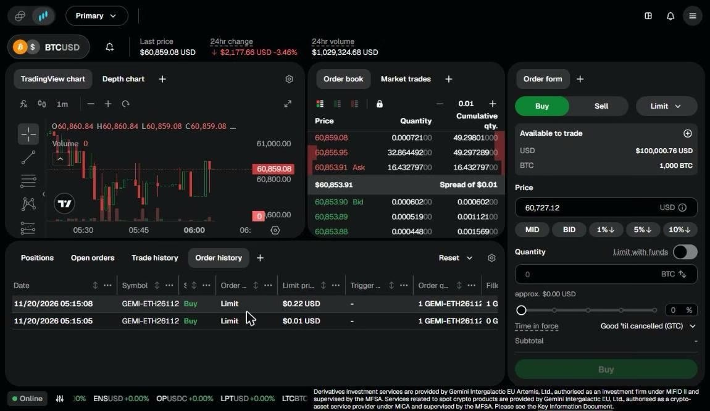
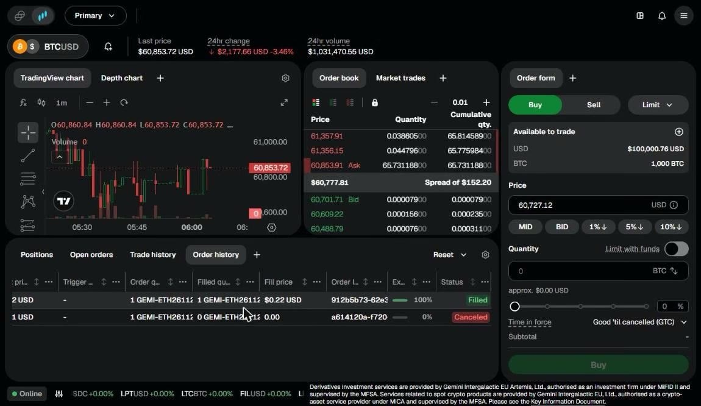
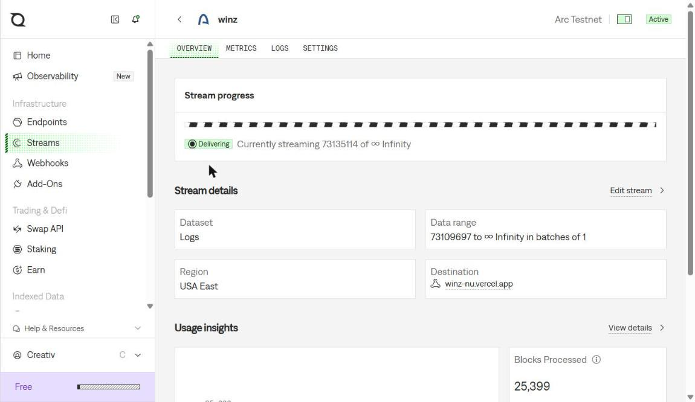
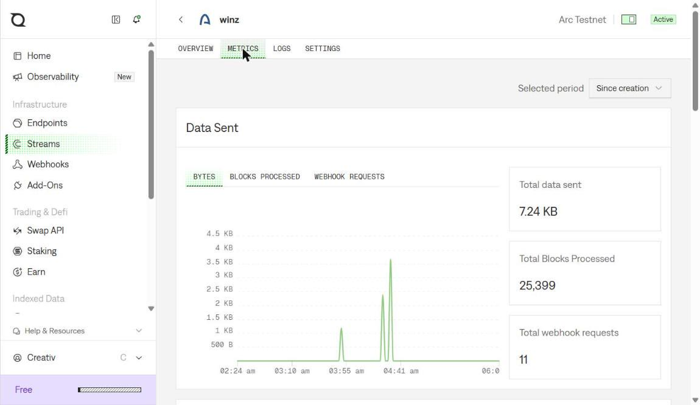

# Winz

Winz lets a shop run a game-night promo like "free if Texas wins" and know its cost before the
first sale. Each sale is covered on the prediction market of Gemini, the exchange, as it is paid.

**[Live app](https://winz-nu.vercel.app)** ·
**[Hedge desk](https://winz-nu.vercel.app/hedge-desk)** (every cover order, public) ·
**[Production receipts](docs/receipts/prod/settlements-2026-11-19.md)** ·
**[Escrow on Arc testnet](https://explorer.testnet.arc.io/address/0x81d2d4050E617184b2B832c30BE68f8811b37D2c)**

Status on 20 November 2026: deployed and used on Arc testnet with test money only (testnet USDC,
cards in Stripe test mode). Five promos were sold, covered and settled there. The cover runs as
paper fills against Gemini's live order book; real orders were placed on Gemini's sandbox only.
What is not done is under [Limits](#limits).

## One sale, in numbers

Promo 15 on 19 November: a $10 Smash burger, half back if Northeastern vs Butler goes over 169.5
points. Gemini's market put that at about 36 %.

- At the sale, the escrow locks the $5 that may be refunded and forwards the other $5 to the shop.
  The card is paid through Stripe; Winz's treasury puts the matching USDC on-chain.
- The engine buys 5 YES contracts, each worth $1 if the game goes over: 5 × $0.36 plus a $0.081
  fee, $1.881, charged to the shop's promo budget. The quote signed for that sale capped it at
  $1.931, and the contract refuses any charge above the cap.
- Over 169.5: the fan gets $5 back from the escrow, and the 5 contracts pay $5, which the treasury
  passes to the shop (`payMerchant`). Not over: the escrow releases the $5 to the shop. Either way
  the shop keeps its $10 and has paid $1.881, about 19 % of the price.
- The game stayed under: the shop kept its $10 ([settlement](https://explorer.testnet.arc.io/tx/0x408942bb054f3c5e8f897115c9031cd6c9dffd227a82ba08986fa2f599eec46f)).

The chance moves after launch, so the cost per sale is held two ways. Each sale's cover is capped
by its signed quote, and sales pause when the chance passes what the shop's margin can pay. The
escrow is on-chain so that the fan's refund is locked at the sale and paid by the contract, never
out of Winz's treasury. If a promo is still unsettled 7 days after sales close, a ticket holder can
claim the refund directly (`emergencyClaim`). In production the cover is paper, so in the over case the
treasury would pay the shop's $5 from its own testnet USDC, not from a real Gemini payout.

## How it works

1. **The merchant launches a promo from a phone.** They pick a game from Gemini's catalogue, a
   condition, the share refunded, the margin they want to keep on each sale after the cover's
   cost, and a budget for the cover, paid by card.
   Before launch, the screen shows the cost per sale and the chance above which sales pause. The
   engine opens the campaign on the escrow (`createCampaignFor`).
2. **The fan pays the normal price** with Apple Pay and gets a live ticket showing the chance the
   condition comes true. The engine records the sale with `buyFor`, carrying a quote signed by the
   oracle that caps what covering this sale may cost.
3. **Each sale is covered on Gemini.** The engine buys YES contracts on the game's market, each
   paying $1 if the condition comes true, for the refundable amount: a resting limit order first,
   a market order if it does not fill. It bills the real cost to the merchant's budget with
   `chargeHedge`; the contract refuses a charge above the quote's cap. In production these are
   paper fills against Gemini's live book.
4. **Gemini publishes the result**, which the engine reads.
5. **The escrow on Arc settles.** If the condition came true, `refundBatch` pays every ticket its
   promised share in USDC from the escrow, `payMerchant` pays the merchant what the YES contracts
   paid (from the treasury), and `release` returns the unspent budget. If not, `release` pays the
   merchant the escrowed share and the budget left.

```text
merchant phone --card (Stripe test)--> web (Vercel) --job--> engine (Render)
fan phone ------Apple Pay (Stripe test)--> web --job--> engine
engine <--catalogue, order book, results-- Gemini
engine --orders--> paper venue on Gemini's live book | Gemini sandbox (proof run)
engine --createCampaignFor, buyFor, chargeHedge, settle, refundBatch, payMerchant, release--> WinzEscrow (Arc testnet)
WinzEscrow logs --QuickNode Stream--> web POST /api/webhooks/quicknode --> chain_events <-- engine (receipt, eth_getLogs)
```

## Proven in production on 19 and 20 November

One merchant account we ran, Buzzball's shop, sold a Smash burger under five promos, each
promising 50 % back.
"Settled after" runs from Gemini's published result to the block of `CampaignSettled`. Source: [`settlements-2026-11-19.md`](docs/receipts/prod/settlements-2026-11-19.md).

| Promo | Condition | Price | Burgers sold | Gemini result | Settled after | On-chain settlement |
| --- | --- | --- | --- | --- | --- | --- |
| 15 | Over 169.5 points, Northeastern vs Butler | $10 | 1 | No | 192 s | [settled](https://explorer.testnet.arc.io/tx/0x408942bb054f3c5e8f897115c9031cd6c9dffd227a82ba08986fa2f599eec46f), [released to the merchant](https://explorer.testnet.arc.io/tx/0xda8b02d15b410748575d144280aeb397268ee8da5f4510a5617374f90cce2216) |
| 16 | Golden State wins | $12 | 1 | No | 12 s | [settled](https://explorer.testnet.arc.io/tx/0x0aecf75bb08c229651f7dd9b9784635d300a977a6933a5d7f446176eb8463b76), [released to the merchant](https://explorer.testnet.arc.io/tx/0x7a52f69c504e31c2441ca880194ef9af841fbcb4bb0d29930a7f2063ea69a57f) |
| 17 | Memphis wins by 15+ | $12 | 2 ($24) | **Yes** | 14 s | [settled](https://explorer.testnet.arc.io/tx/0x310bed1d85fd0c967875b03551075c2805ae078e6bfe69c462f1cda62e95a4d0), [$12.00 (half of $24) refunded to the fan](https://explorer.testnet.arc.io/tx/0xf704c9b68cfe44b9b5c8ccee44b3eeff5476b1c46bc7f5a6795fe50530449935), [$12.00 paid to the merchant](https://explorer.testnet.arc.io/tx/0x479b0b3be6a110d9d2fc9556b40aef722ae82937b5aac764af8bf8cff133f3ef), [budget left released](https://explorer.testnet.arc.io/tx/0xcb07030e2ed524887c28d6a06cc7436ab997ef02b6c2e3248a39cf76d6c67253) |
| 18 | New York wins by 10+ | $12 | 1 | No | 17 s | [settled](https://explorer.testnet.arc.io/tx/0x60df923f45da36b8b5ca31896ef8b93a0f0e223cf4a94f3436d250035053bd65), [released to the merchant](https://explorer.testnet.arc.io/tx/0xd629b3ac0871be06c3a98967d7aadeb6032dfe37c5e2c86d23d436482234a571) |
| 19 | Minnesota wins by 9+ | $12 | 1 | No | 15 s | [settled](https://explorer.testnet.arc.io/tx/0xb22ddd1af806f7f79b0702ea1e67ad4d2236ab5054ee7a8fa42500151ac5354b), [released to the merchant](https://explorer.testnet.arc.io/tx/0xd9903ec3ad126857b29ed10671dcc4ecbc6b129fb8cad0b6122c56655694b273) |

Promo 15 was settled by the engine started at 01:02 UTC, the four NBA promos by the engine
redeployed at 02:55 UTC; the receipt does not say why the first took longer. The purchases were
paid with Apple Pay on an iPhone, in Stripe test mode, and filmed.

The first sale, from its [receipt](docs/receipts/prod/g1-2026-11-19.md): card payment at
23:40:00 UTC, `buyFor` mined at 23:40:03, cover filled at 23:40:10.8, `chargeHedge` mined at
23:40:14. The cover cost 1.881 USDC against a cap of 1.931 set by the quote.



Promo 15's poster, as production served it.

## Gemini

**What Winz uses, and why.** The promo's cost comes from Gemini's prediction market. Its
catalogue lists the games and conditions a merchant can choose. Its live book prices each sale and
pauses a promo when the chance passes what the margin can pay. YES contracts on that market cover
each sale, and Gemini's result settles the promo.

**How it is built.**

- Catalogue: [`gemini-rest-client.ts`](apps/engine/src/market-data/gemini-rest-client.ts) and
  [`catalog-leagues.ts`](apps/engine/src/market-data/catalog-leagues.ts). Gemini's listing stops
  near 1,000 events, so the engine reads one per league ([engine README](apps/engine/README.md)).
- Live book: [`ws-book-transport.ts`](apps/engine/src/market-data/ws-book-transport.ts) subscribes
  to `wss://ws.gemini.com` and reconnects with exponential backoff.
  [`book-feed.ts`](apps/engine/src/market-data/book-feed.ts) falls back to the REST book
  ([`rest-book-poller.ts`](apps/engine/src/market-data/rest-book-poller.ts)) when the socket is
  silent or down, and marks a book older than 10 s stale.
- Cost of a sale: [`packages/pricing`](packages/pricing/src) (taker fee 0.07 × p × (1 − p) per
  contract, marginal cost through the asks, quote, pause threshold).
- Execution: [`hedging/policy`](apps/engine/src/hedging/policy) places maker orders first, then
  taker, behind one `ExecutionVenue` interface. Production uses
  [`paper-venue.ts`](apps/engine/src/venues/paper-venue.ts), which fills against Gemini's live
  book. The Hedge desk labels it "PAPER · live Gemini book".
- Real orders: [`venues/gemini/`](apps/engine/src/venues/gemini) signs requests with HMAC-SHA384
  ([`signer.ts`](apps/engine/src/venues/gemini/signer.ts)). It calls the `/v1/prediction-markets/`
  order, cancel and order-history routes ([`client.ts`](apps/engine/src/venues/gemini/client.ts)).
  [`check.ts`](apps/engine/src/venues/gemini/check.ts) runs the proof.
- Results: [`market-data/settlement.ts`](apps/engine/src/market-data/settlement.ts) maps Gemini's
  resolution to yes, no or void; [`settlement/`](apps/engine/src/settlement) runs the escrow calls.

**How it is verified.**

- [`signer.test.ts`](apps/engine/src/venues/gemini/signer.test.ts) checks the HMAC-SHA384
  signature against a vector computed with openssl.
- [`venue.test.ts`](apps/engine/src/venues/gemini/venue.test.ts) and
  [`check.test.ts`](apps/engine/src/venues/gemini/check.test.ts) run against
  [`sim-server.ts`](apps/engine/src/venues/gemini/sim-server.ts), a local Gemini that recomputes
  every signature and requires a strictly increasing nonce. They cover a maker refused as
  `would_cross`, a lost placement found by its terms, a 429, and a failed check that leaves no
  order resting.
- [`paper-venue.test.ts`](apps/engine/src/venues/paper-venue.test.ts) and its
  [property test](apps/engine/src/venues/paper-venue.property.test.ts): a taker never fills past
  the displayed depth, and a book exactly 10 s old is accepted while one 1 ms older is refused.
- [`ws-book-transport.test.ts`](apps/engine/src/market-data/ws-book-transport.test.ts) replays
  frames recorded from Gemini's WebSocket ([`fixtures/gemini-ws`](apps/engine/fixtures/gemini-ws)).
- [`market-data/settlement.test.ts`](apps/engine/src/market-data/settlement.test.ts) maps recorded
  settled pages to yes, no and void.

**Production proof.**

- Real orders on the sandbox, 20 Nov at 04:15 UTC, outcome `proven`, contract
  `GEMI-ETH2611200500-HI1720`: maker order `145853902324436356` placed (buy 1 at 1 %) then
  cancelled, taker order `145853902324436442` filled (buy 1 at 22 %). The panel "Real orders on
  Gemini sandbox" on the [Hedge desk](https://winz-nu.vercel.app/hedge-desk) shows them. The
  sandbox lists no sports market, so the proof uses a crypto contract through the same adapter.
- The same two orders in the sandbox account's own order history: the $0.01 limit order canceled,
  the $0.22 limit order filled 100 %. The page shows its own time zone and order ids; the seconds
  (:05 and :08) are those of the proof.

  
  
- Settled from Gemini's results in 12 to 17 s (NBA promos) and 192 s (NCAAM promo).

## QuickNode

**What Winz uses, and why.** The engine must see every sale on the escrow to cover it. A QuickNode
Stream pushes the escrow's events to the web app, a third path beside the relayer's transaction
receipt and an `eth_getLogs` poll every 5 s. The first path to arrive writes the event.

**How it is built.**

- The Stream reads Arc testnet's Logs dataset through a filter that keeps the escrow's logs only
  (code and settings in [`docs/quicknode.md`](docs/quicknode.md)).
- Its destination is `POST /api/webhooks/quicknode`
  ([`route.ts`](apps/web/app/api/webhooks/quicknode/route.ts),
  [`quicknode-webhook.ts`](apps/web/lib/server/quicknode-webhook.ts)). Each delivery is verified on
  its raw body: HMAC-SHA256 of nonce, timestamp and uncompressed body, keyed with the Stream's
  token and compared in constant time.
- Logs go to `chain_events` with source `streams`, `on conflict (tx_hash, log_index) do nothing`.
- [`docs/deploy.md`](docs/deploy.md) sets the engine's `ARC_RPC_URL` to a QuickNode Arc testnet
  endpoint, with the public RPC as `ARC_RPC_FALLBACK_URL`.

**How it is verified.**

- [`quicknode-webhook.test.ts`](apps/web/lib/server/quicknode-webhook.test.ts): another token, a
  tampered body or a missing header gets 401 and stores nothing; the same delivery twice changes
  nothing; a log flagged `removed` is never stored; the token, signatures and nonces never reach a
  log.
- [`quicknode-webhook.contract.test.ts`](apps/web/lib/server/quicknode-webhook.contract.test.ts):
  for every escrow event, the row from the webhook is byte-identical to the rows from the receipt
  and the poller, with a positive control that a differing row is caught.
- [`e2e/quicknode.test.ts`](apps/web/e2e/quicknode.test.ts): on a local chain, one event from
  three sources gives one row, applied once, whichever arrives first.

**Production proof.**

- Eight settlement events in the receipt were written by the Stream before the relayer's receipt,
  among them promo 17's
  [refund](https://explorer.testnet.arc.io/tx/0xf704c9b68cfe44b9b5c8ccee44b3eeff5476b1c46bc7f5a6795fe50530449935)
  and [merchant payout](https://explorer.testnet.arc.io/tx/0x479b0b3be6a110d9d2fc9556b40aef722ae82937b5aac764af8bf8cff133f3ef).
- Measured on 20 Nov over the previous 6 hours of production `chain_events` (read-only), from each
  event's block timestamp to its write (query and figures in the
  [receipt](docs/receipts/prod/settlements-2026-11-19.md#quicknode-streams)):

  | Path that wrote the event first | Events | Average | Min | Max |
  | --- | --- | --- | --- | --- |
  | `streams` (QuickNode delivery) | 8 | 1.04 s | 0.55 s | 1.58 s |
  | `receipt` (relayer's own receipt) | 19 | 1.49 s | 0.59 s | 3.51 s |

  Each row covers only the events its path won, so it compares winners, not both paths on one
  event.
- The Stream in QuickNode's dashboard on 20 Nov: active and delivering, Arc testnet, Logs, batches
  of 1, destination `winz-nu.vercel.app`; 25,399 blocks processed, 11 webhook requests sent (the
  filter sends only blocks with an escrow event), 0 errors.

  
  

## Arc

**What Winz uses, and why.** The escrow holds the money the promise depends on, in USDC, and the
contract, not Winz's database, pays it out. The result itself is posted by Winz's oracle key
(`settle` is oracle-only), copied from Gemini's published result. Gas on Arc is paid in USDC too, so the
relayer and oracle hold one token. Fans and merchants never send a transaction; the relayer does.

**How it is built.** [`WinzEscrow.sol`](packages/contracts/src/WinzEscrow.sol), interface
[`IWinzEscrow.sol`](packages/contracts/src/interfaces/IWinzEscrow.sol), Foundry, Solidity 0.8.28.

- Budget: `createCampaignFor` pulls the campaign's budget from the treasury, and `topUpBudgetFor`
  adds to it.
- Tickets: `buyFor` checks the oracle's EIP-712 quote, locks the refundable share, forwards the
  rest to the merchant, and reserves the cover's cap on the budget.
- Cover charges: `chargeHedge` pays the treasury the real cost and reverts above the reservation.
- Settlement: `settle` (oracle only), then `refundBatch`, `payMerchant` and `release`.
  `emergencyClaim` lets a ticket holder take the refundable amount if a campaign is still unsettled
  7 days after sales close.
- Deployed on 17 Nov at block 72727350, source verified on the
  [explorer](https://explorer.testnet.arc.io/address/0x81d2d4050E617184b2B832c30BE68f8811b37D2c).
  The token is Arc's USDC ERC-20 interface `0x3600000000000000000000000000000000000000`
  ([`deployments/5042002.json`](packages/contracts/deployments/5042002.json)). The deployment cost
  about 0.076 USDC of gas ([`docs/arc-testnet.md`](docs/arc-testnet.md)).

**How it is verified.** `pnpm --filter @winz/contracts test` ran 203 tests in 13 suites, all
passing, on 20 Nov, then checked that the committed ABI matches the compiler's output.

- [`WinzEscrowPurchase.t.sol`](packages/contracts/test/WinzEscrowPurchase.t.sol),
  [`WinzEscrowHedge.t.sol`](packages/contracts/test/WinzEscrowHedge.t.sol) (fuzzed: a charge never
  exceeds its cap),
  [`WinzEscrowSettlement.t.sol`](packages/contracts/test/WinzEscrowSettlement.t.sol),
  [`WinzEscrowCampaign.t.sol`](packages/contracts/test/WinzEscrowCampaign.t.sol),
  [`WinzEscrowEmergency.t.sol`](packages/contracts/test/WinzEscrowEmergency.t.sol).
- [`WinzEscrowTokenBehaviour.t.sol`](packages/contracts/test/WinzEscrowTokenBehaviour.t.sol): a
  token that returns false leaves that ticket owed, and a reentrant token cannot reenter.
- [`invariant/WinzEscrowInvariant.t.sol`](packages/contracts/test/invariant/WinzEscrowInvariant.t.sol):
  solvency, locked refunds equal to unpaid tickets, cover accounting, and terms that never change.
  Its `test_control_*` cases break them on purpose and check that they fail.
- [`script/DeployScript.t.sol`](packages/contracts/test/script/DeployScript.t.sol): the deploy
  script refuses Ethereum and Arc mainnets and any deployment that does not read back.

**Production proof.** The five promos above. Ticket 674 of promo 17 was
[refunded on-chain](https://explorer.testnet.arc.io/tx/0xf704c9b68cfe44b9b5c8ccee44b3eeff5476b1c46bc7f5a6795fe50530449935)
$12.00, half of the $24.00 paid, 3 s after `settle`. In a rehearsal on 18 Nov, 300 tickets were
refunded in 6 batches within 8 blocks, 4 s of chain time after `settle`
([receipt](docs/rehearsals/20261118T170112Z-5042002-yes.md)).

## Architecture and layout

| Path | What it is |
| --- | --- |
| [`apps/web`](apps/web) | Next.js app on Vercel: merchant and fan screens, Hedge desk, API routes, Stripe and QuickNode webhooks |
| [`apps/engine`](apps/engine) | Node process on Render: the only one that talks to Gemini and sends transactions |
| [`packages/contracts`](packages/contracts) | `WinzEscrow`, its Foundry tests and deploy scripts |
| [`packages/pricing`](packages/pricing) | Cost of a sale from a book: fees, marginal taker cost, quote, limits, promo templates |
| [`packages/shared`](packages/shared) | Units (micro-USDC, basis points), API schemas, escrow ABI, EIP-712 quote, job types |
| [`supabase`](supabase) | Postgres migrations, SQL tests and seed (Supabase in production) |

Sign-in uses Privy (e-mail code). Engine health: [`/healthz`](https://winz-kfwm.onrender.com/healthz).
CI ([`ci.yml`](.github/workflows/ci.yml)) runs lint, typecheck, the package, script and schema
tests, and the build.

## Run it

Node 22+ and pnpm 10. The engine and web tests start a throwaway Postgres (set `PG_BIN`
if needed) and a local Anvil chain. The engine suite never calls Gemini, Stripe or a real network.

```bash
pnpm install
pnpm lint && pnpm typecheck
pnpm test                               # every package, through turbo
pnpm --filter @winz/contracts test      # Foundry, then the committed ABI check
pnpm --filter @winz/engine test
pnpm --filter @winz/web test
pnpm --filter @winz/pricing test
pnpm db:test                            # schema assertions in supabase/tests
pnpm e2e:ui                             # Playwright, iPhone 15 viewport, simulated API
pnpm smoke https://winz-nu.vercel.app --engine https://winz-kfwm.onrender.com
```

The screens run without any service or secret on the simulated API:
`APP_API_MOCK=true NEXT_PUBLIC_APP_API_MOCK=true pnpm --filter @winz/web dev`. Deploying the stack
takes accounts and keys ([`docs/deploy.md`](docs/deploy.md)).

## Limits

- **Testnet and test mode.** Every promo ran on Arc testnet with testnet USDC, and every card
  payment, Apple Pay included, in Stripe test mode. The USDC that enters the escrow
  comes from Winz's treasury wallet, not from the card.
- **Production cover is paper.** The engine fills its orders against Gemini's live production book
  without sending them. Real orders were proven on the sandbox only, on a crypto contract. Orders
  to Gemini's production venue are refused in code (`createVenue`).
- **Small sample.** Five promos, six burgers, one Yes result, one merchant account we ran.
- **The oracle is ours.** Winz's oracle key signs the quotes and posts the result Gemini published;
  the contract bounds what it can do (caps, refunds locked at the sale, `emergencyClaim` after 7
  days) but trusts it for the outcome.
- **Not done yet.** Among the targets still open on 20 Nov:
  - The browser suite against the real stack. `pnpm e2e:ui` runs on the simulated API in
    Chromium, not on Safari, Privy, Stripe or the chain ([UI receipts](docs/receipts/ui/README.md)).
  - A sale on the merchant's dashboard within 3 s under load: with three buyers at once on
    the public node the median was 3.0 s on 18 Nov (one sale at a time: 1.1 to 2.5 s). The 300
    tickets refunded within 10 s of `settle` were met (4 s, same rehearsal).
  - Timing the merchant and fan flows on a phone with real Apple Pay.
  - Two full rehearsals in a row on testnet with no manual fix.
  - A recorded QuickNode delivery saved as a test file:
    [`fixtures/quicknode`](apps/engine/fixtures/quicknode) holds only its README.
- **Language.** The production receipts, `apps/web/README.md` and three docs (`deploy.md`,
  `quicknode.md`, `gemini-sandbox.md`) are in French.
